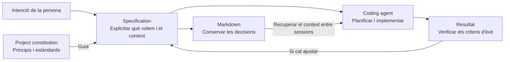
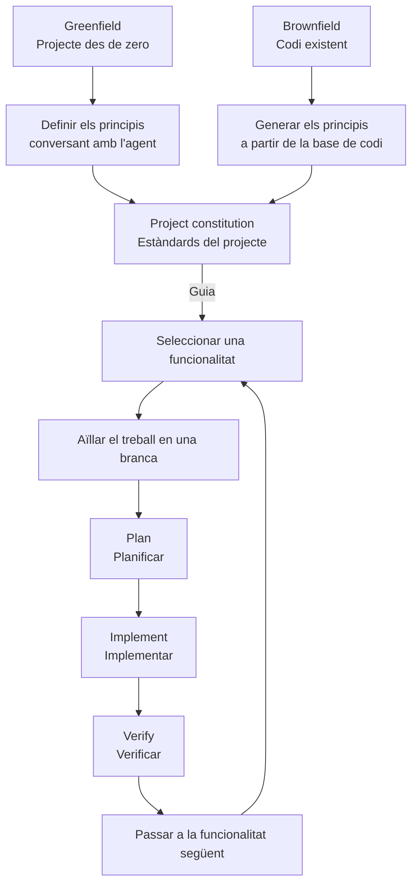

# 01 · Introduction

[← Índex](../README.md) · [Vídeo i transcripció original](https://learn.deeplearning.ai/courses/spec-driven-development-with-coding-agents/lesson/8bhg0p/introduction)

Guia de lectura compartida per a DAW2. Les definicions són explicacions didàctiques en català a partir de la introducció; els diagrames sintetitzen les relacions entre les idees.

## 1. Conceptes clau

**Spec-Driven Development — Desenvolupament guiat per especificacions:** metodologia en què explicitem què volem construir i el context necessari perquè un agent ho implementi. És el concepte paraigua dels cinc dominis següents.

### 1.1. Definició i decisions del projecte

| Keyword | Significat |
|---|---|
| **Specification (spec)** | **Especificació.** Recull què cal construir, el problema, les funcionalitats, els criteris d'èxit i les restriccions. |
| **Success criteria** | **Criteris d'èxit.** Condicions per comprovar si el resultat compleix l'objectiu. |
| **Constraints** | **Restriccions.** Límits i requisits que la solució ha de respectar. |
| **Trade-offs** | **Compromisos entre alternatives.** Decisions que prioritzen uns avantatges assumint altres costos o limitacions. |

### 1.2. Agents i gestió del context

| Keyword | Significat |
|---|---|
| **Coding agent** | **Agent de programació.** Sistema d'IA que planifica i implementa codi a partir de les instruccions i del context. |
| **Context** | **Context.** Informació específica del projecte que l'agent necessita: objectius, decisions, preferències i limitacions. |
| **Context decay** | **Pèrdua de context.** Pèrdua d'informació rellevant entre sessions; documentar-la ajuda a recuperar-la. |
| **Stateless** | **Sense estat persistent.** La lliçó presenta els agents com a sistemes als quals cal proporcionar el context important en iniciar cada sessió. |
| **Markdown** | Format de text amb marques senzilles que permet deixar les especificacions i les decisions en fitxers llegibles per persones i agents. |

### 1.3. Organització del desenvolupament

| Keyword | Significat |
|---|---|
| **Project constitution** | **Constitució del projecte.** Principis i estàndards fonamentals que han de guiar el desenvolupament del projecte. |
| **Feature development loop** | **Cicle de desenvolupament d'una funcionalitat.** Repetició dels passos de planificació, implementació i verificació per a cada funcionalitat. |
| **Branch** | **Branca.** Línia de treball del control de versions que permet aïllar el desenvolupament d'una funcionalitat. |
| **Agent skills** | **Habilitats de l'agent.** Instruccions reutilitzables per automatitzar parts del flux de treball. La introducció anuncia que es treballaran durant el curs. |

### 1.4. Punt de partida del projecte

| Keyword | Significat |
|---|---|
| **Greenfield project** | **Projecte des de zero.** La constitució es defineix conversant amb l'agent abans de desenvolupar les funcionalitats. |
| **Brownfield project** | **Projecte sobre codi existent.** La constitució es genera a partir de la base de codi que ja existeix. |

### 1.5. Qualitat del resultat

| Keyword | Significat |
|---|---|
| **Intent fidelity** | **Fidelitat a la intenció.** Grau en què el resultat reflecteix el que la persona volia construir. |
| **Maintainable code** | **Codi fàcil de mantenir.** Codi que es pot entendre, modificar i ampliar. La lliçó assenyala que deixar decisions importants a l'agent sense especificar-les pot perjudicar-ne el manteniment. |

## 2. Mapes i diagrames

### De la intenció al resultat

Les fletxes indiquen relacions entre les idees; aquest esquema no és una seqüència formal d'OpenSpec.

La introducció destaca tres beneficis: controlar grans canvis de codi amb petits canvis a l'especificació, reduir la pèrdua de context i millorar la fidelitat a la intenció.

### Del projecte a cada funcionalitat

Les **Agent skills** permeten automatitzar parts d'aquest flux. El vídeo n'anuncia l'ús, però encara no en concreta la implementació.

## 3. Contrast amb la vostra metodologia de l'Sprint 1.2

Partiu de la metodologia pròpia que heu definit amb OpenSpec i de l'experiència d'aplicar-la sobre una funcionalitat ja desenvolupada amb altres metodologies.

Completeu la taula amb evidències concretes: un document, una decisió, un canvi al codi, una branca o un resultat de verificació. Podeu proposar una millora o justificar per què manteniu el vostre plantejament.

| Aspecte del vídeo | Ja ho contemplàveu? Com? | Com us va funcionar en aplicar-ho? | Introduiríeu alguna millora? Per què? |
|---|---|---|---|
| Explicitar el problema, les funcionalitats, els criteris d'èxit i les restriccions abans d'implementar. | | | |
| Decidir l'arquitectura i els compromisos entre alternatives, deixant constància de les decisions. | | | |
| Conservar i recuperar el context important entre sessions de l'agent. | | | |
| Definir principis comuns del projecte a partir del codi existent. | | | |
| Treballar per funcionalitats, amb aïllament en branques i passos de planificació, implementació i verificació. | | | |
| Valorar si el resultat reflecteix la intenció inicial i facilita el manteniment. | | | |
| Identificar passos repetits que es podrien automatitzar amb habilitats reutilitzables. | | | |

No cal adoptar totes les propostes del curs. La finalitat és revisar les vostres decisions amb evidències de l'aplicació pràctica.
