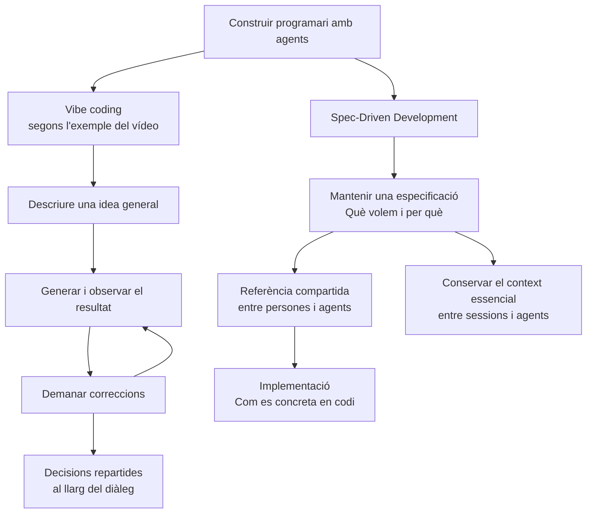
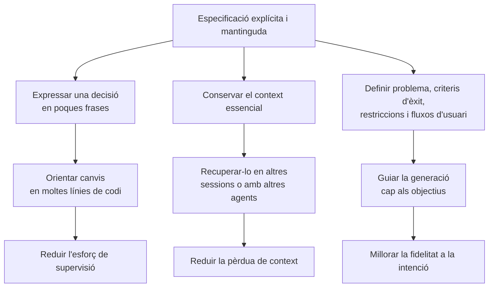

# 02 · Why spec-driven development?

[← Índex](../README.md) · [← Lliçó 1](01-introduccio.md) · [Vídeo i transcripció original](https://learn.deeplearning.ai/courses/spec-driven-development-with-coding-agents/lesson/9i8xmt/why-spec%E2%88%92driven-development%3F)

Guia de lectura compartida per a DAW2. Les explicacions i els diagrames sintetitzen la transcripció de la lliçó.

La pregunta central és com passar dels ajustos successius mitjançant prompts a un procés d'enginyeria amb decisions explícites i duradores. El vídeo proposa separar **què volem i per què** de **com s'implementa**, mantenint una especificació compartida entre persones i agents.

## 1. Conceptes clau

Els dominis agrupen els conceptes segons la funció que tenen en aquesta lliçó. Alguns termes reprenen la introducció i n'amplien el significat.

### 1.1. Enfocament de desenvolupament

| Keyword | Significat |
|---|---|
| **Vibe coding** | En l'exemple del vídeo, programar descrivint una idea general i demanant correccions successives a l'agent fins que el resultat sembla satisfactori. Es presenta com una via ràpida amb limitacions per a projectes grans i continuats. |
| **Spec-Driven Development (SDD)** | **Desenvolupament guiat per especificacions.** Parteix d'una especificació mantinguda que orienta la generació de codi i conserva les decisions. |
| **Software development life cycle** | **Cicle de vida del desenvolupament de programari.** El vídeo proposa traslladar a la programació amb agents les pràctiques d'enginyeria apreses durant el desenvolupament de programari. |

### 1.2. Definició i acord sobre el producte

| Keyword | Significat |
|---|---|
| **Specification / Implementation** | **Especificació / Implementació.** Separació entre què es vol i per què, i com es concreta en codi. |
| **Technical artifact** | **Artefacte tècnic.** Resultat documentat que perdura i es pot consultar i mantenir. En aquesta lliçó, és l'especificació. |
| **Contract** | **Acord compartit.** Metàfora per descriure l'especificació com a referència comuna entre les persones i també amb l'agent; no s'utilitza en sentit jurídic. |
| **Success criteria** | **Criteris d'èxit.** Condicions definides abans de generar codi per valorar si s'ha resolt el problema. |
| **Constraints** | **Restriccions.** Límits i requisits que orienten les solucions possibles. |
| **User flows** | **Fluxos d'usuari.** Seqüències d'accions amb què una persona assoleix un objectiu dins de l'aplicació. Cal explicitar-les perquè l'agent entengui el comportament esperat. |
| **Stakeholders** | **Parts interessades.** Persones implicades o afectades pel producte. L'especificació en llenguatge natural els facilita participar en la comprensió del que es vol construir. |

### 1.3. Context i esforç de supervisió

| Keyword | Significat |
|---|---|
| **Context window** | **Finestra de context.** Quantitat limitada d'informació amb què el model pot treballar en un moment determinat. El vídeo adverteix que l'acumulació de context pot anar acompanyada de més errors. |
| **Context decay** | **Pèrdua de context útil.** Dificultat per conservar presents les decisions rellevants al llarg de la conversa o entre sessions. Les especificacions persistents permeten tornar a aportar el context essencial. |
| **Cognitive overhead** | **Sobrecàrrega cognitiva.** Esforç mental necessari per seguir, controlar i corregir el treball de l'agent. La lliçó proposa reduir-lo expressant canvis a través de l'especificació. |

### 1.4. Eines i responsabilitats

| Keyword | Significat |
|---|---|
| **Chatbot / Coding agent** | **Assistent conversacional / Agent de programació.** La lliçó contraposa un xat que respon sobre codi amb un agent que pot planificar i utilitzar la base de codi i les eines de desenvolupament. La distinció depèn de les capacitats i els accessos disponibles, no només del nom del producte. |
| **Pair programmer** | **Company de programació.** Paper que s'atribueix a l'agent: aporta capacitat tècnica i rapidesa, mentre la persona orienta el treball. |
| **Senior architect** | **Responsable d'arquitectura.** Metàfora del paper humà: transformar les intencions en especificacions clares i aportar les directrius del projecte. |

### 1.5. Qualitat i evolució del resultat

| Keyword | Significat |
|---|---|
| **Technical debt** | **Deute tècnic.** Cost futur de corregir o mantenir solucions que s'han resolt de manera deficient o precipitada. El vídeo el relaciona amb generar codi a partir d'instruccions massa generals. |
| **Disposable code** | **Codi d'un sol ús.** Codi pensat per obtenir un resultat immediat que pot resultar poc adequat per continuar evolucionant un producte. |
| **Intent fidelity** | **Fidelitat a la intenció.** Correspondència entre el codi generat i els objectius de la persona. |
| **Drift** | **Desviació.** Allunyament progressiu del resultat respecte de la direcció prevista per al projecte. |

## 2. Mapes i diagrames

### Dos enfocaments per orientar la generació de codi

Aquest esquema resumeix la comparació que planteja el vídeo; no implica que qualsevol ús de prompts breus produeixi necessàriament mal codi.

### Tres beneficis i els mecanismes que els expliquen

Cada branca relaciona una pràctica amb el benefici que la lliçó li atribueix.

El vídeo també compara el pas d'especificació a codi amb el d'un compilador que transforma codi font en codi màquina. És una **analogia didàctica**: la generació amb agents continua requerint supervisió i verificació.

## 3. Contrast amb la vostra metodologia de l'Sprint 1.2

Reviseu el que vau definir amb OpenSpec i el que va passar quan ho vau aplicar a la funcionalitat ja desenvolupada. Aporteu evidències concretes: especificacions, converses, canvis al repositori o resultats de verificació.

| Aspecte del vídeo | Ja ho contemplàveu? Com? | Com us va funcionar en aplicar-ho? | Introduiríeu alguna millora? Per què? |
|---|---|---|---|
| Distingir què volíeu i per què de les decisions sobre com implementar-ho. | | | |
| Incorporar a l'especificació les decisions que sorgien en les converses i mantenir-la actualitzada. | | | |
| Definir criteris d'èxit, restriccions i fluxos d'usuari abans de generar codi. | | | |
| Recuperar el context essencial en canviar de sessió o d'agent. | | | |
| Concretar què decidíeu vosaltres i què delegàveu a l'agent, amb accés al codi i a les eines necessàries. | | | |
| Valorar si corregir el resultat a través de prompts successius us va generar esforç extra o deute tècnic. | | | |
| Comprovar que la funcionalitat complia la intenció inicial i era adequada per continuar evolucionant el projecte. | | | |

Podeu mantenir una decisió pròpia si l'experiència la justifica. Diferencieu entre tenir un aspecte escrit a la metodologia i haver-lo aplicat amb bons resultats.
