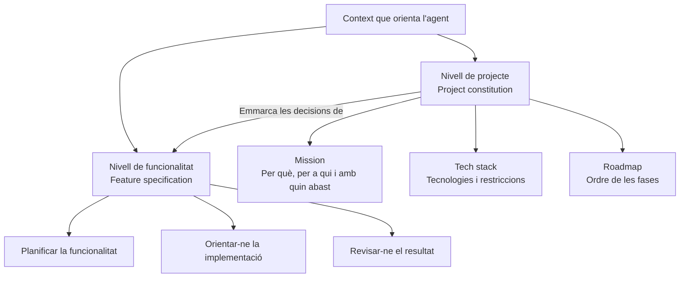
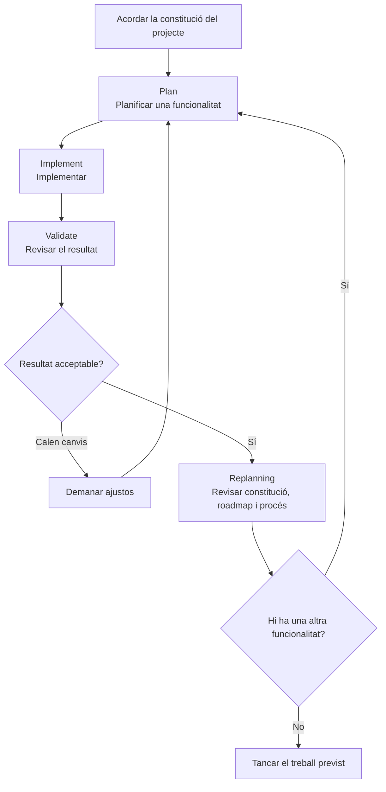

# 03 · Workflow overview

[← Índex](../README.md) · [← Lliçó 2](02-per-que-spec-driven-development.md) · [Vídeo i transcripció original](https://learn.deeplearning.ai/courses/spec-driven-development-with-coding-agents/lesson/vtd82x/workflow-overview)

Guia de lectura compartida per a DAW2, elaborada a partir de la transcripció de la lliçó.

El vídeo presenta un flux amb tres moments: acordar les decisions del projecte, desenvolupar cada funcionalitat i replanificar entre funcionalitats. Una idea transversal és aportar el context que l'agent desconeix amb el nivell de detall adequat.

## 1. Conceptes clau

### 1.1. Decisions del projecte

| Keyword | Significat |
|---|---|
| **Project constitution** | **Constitució del projecte.** Forma estructurada de recollir els acords clau entre les persones i amb l'agent sobre la missió, les tecnologies i el full de ruta. |
| **Mission** | **Missió.** Explica el perquè del projecte: visió, públic destinatari i abast. Orienta les decisions posteriors. |
| **Target audience** | **Públic destinatari.** Persones per a les quals es construeix el producte; les seves necessitats formen part del context que cal explicitar. |
| **Scope** | **Abast.** Delimita què cobreix el projecte. |
| **Tech stack** | **Conjunt de tecnologies.** Acord sobre les tecnologies de desenvolupament i desplegament, amb les seves restriccions. |
| **Roadmap** | **Full de ruta.** Document viu que ordena les fases del projecte. Les fases es concreten mitjançant el procés d'especificació de funcionalitats. |
| **Agent agnostic** | **Independent de l'agent.** La constitució es planteja com una referència que no depèn d'un agent concret. El vídeo la compara amb l'ús d'un fitxer d'instruccions a l'arrel del projecte, habitualment anomenat AGENTS.md; aquí no en defineix cap format obligatori. |

### 1.2. Cicle de desenvolupament i revisió

| Keyword | Significat |
|---|---|
| **Feature** | **Funcionalitat.** Unitat de treball que es desenvolupa mitjançant un procés repetible dins del marc del projecte. |
| **Plan** | **Planificar.** Preparar el desenvolupament de la funcionalitat abans d'implementar-la. |
| **Implement** | **Implementar.** Construir la funcionalitat seguint el que s'ha acordat. |
| **Validate** | **Validar.** Revisar el resultat per acceptar-lo o demanar canvis. La lliçó encara no concreta les tècniques de validació. |
| **Replanning** | **Replanificació.** Revisió entre funcionalitats: reconsiderar la constitució, actualitzar el full de ruta i millorar el procés de treball. |
| **Living document** | **Document viu.** Document que s'actualitza amb l'evolució del projecte; el vídeo aplica aquesta idea al full de ruta. |

### 1.3. Context i delegació

| Keyword | Significat |
|---|---|
| **Level of detail** | **Nivell de detall.** Quantitat i profunditat d'informació que aportem. La proposta és detallar objectius, missió, públic i restriccions, i delegar les decisions de baix nivell que l'agent pot resoldre. |
| **High-quality context** | **Context de qualitat.** Informació rellevant que ajuda l'agent a prendre decisions coherents, tant sobre el projecte com sobre cada funcionalitat. No equival simplement a escriure més text. |
| **Pair programmer** | **Company de programació.** Manera de considerar l'agent com un col·laborador tècnicament capaç, al qual cal aportar sobretot la informació específica que no coneix. |
| **Steer the agent** | **Orientar l'agent.** Guiar-ne el treball durant el desenvolupament i la replanificació: dissenyar, supervisar, revisar i acceptar resultats o demanar ajustos. |

## 2. Mapes i diagrames

### Dos nivells de context

Les branques representen dues escales de decisió. El context de cada funcionalitat s'ha de relacionar amb el marc general del projecte.

### Desenvolupar i replanificar

El retorn dels ajustos a la planificació és una simplificació didàctica: segons el canvi, pot caldre revisar el pla o només la implementació. La lliçó presenta aquest flux com **una proposta de SDD**, no com l'única metodologia possible.

**Matís respecte de la introducció:** la constitució recull els estàndards fonamentals del projecte, però aquesta lliçó explica que també es pot revisar durant la replanificació. Cal distingir els principis que es mantenen dels acords que s'actualitzen de manera deliberada.

## 3. Contrast amb la vostra metodologia de l'Sprint 1.2

Compareu el flux del vídeo amb la metodologia pròpia que heu definit amb OpenSpec i amb la seva aplicació sobre la funcionalitat ja desenvolupada. No cal que els documents tinguin els mateixos noms: compareu la funció que compleixen.

| Aspecte del vídeo | Ja ho contemplàveu? Com? | Com us va funcionar en aplicar-ho? | Introduiríeu alguna millora? Per què? |
|---|---|---|---|
| Separar els acords generals del projecte dels detalls de cada funcionalitat. | | | |
| Explicitar missió, públic destinatari i abast perquè l'agent no els hagi de deduir. | | | |
| Acordar les tecnologies de desenvolupament i desplegament i les restriccions. | | | |
| Mantenir un full de ruta que es pugui revisar a partir de l'experiència. | | | |
| Planificar, implementar i validar cada funcionalitat, amb una decisió explícita d'acceptació o de canvi. | | | |
| Reservar un moment entre funcionalitats per revisar els acords i millorar la metodologia. | | | |
| Triar què cal detallar i quines decisions de baix nivell es poden delegar a l'agent. | | | |

Justifiqueu les respostes amb documents o situacions del vostre treball. Si només heu aplicat la metodologia a una funcionalitat, podeu indicar què encara no heu pogut comprovar i com ho revisaríeu en la següent.
