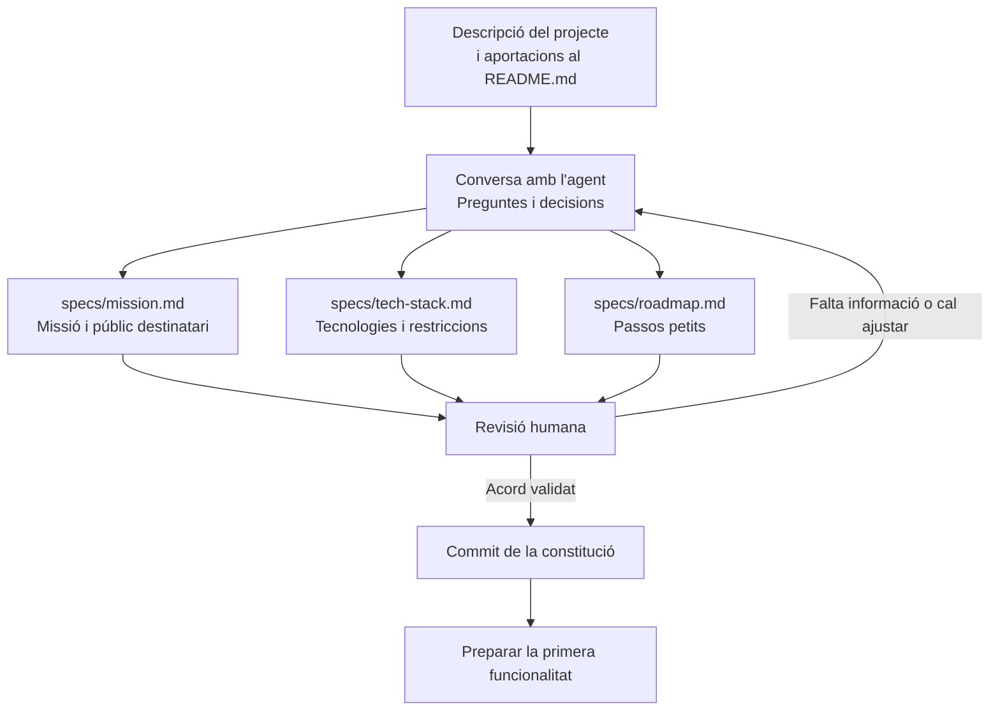

# 06 · Creating the Constitution

[← Índex](../README.md) · [Vídeo i transcripció](https://learn.deeplearning.ai/courses/spec-driven-development-with-coding-agents/lesson/0kj4sq/creating-the-constitution)

**Idea central:** acordar amb l'agent la missió, les tecnologies i el full de ruta abans de desenvolupar funcionalitats. La persona revisa les propostes i valida les decisions.

## 1. Conceptes clau

### Acords del projecte

| Keyword | Significat |
|---|---|
| **Constitution** | **Constitució.** Conjunt d'acords generals que orienten el desenvolupament. En l'exemple es reparteix en tres fitxers. |
| **Mission** | **Missió.** Què es vol construir, per què i per a qui. |
| **Tech stack** | **Conjunt de tecnologies.** Eines i tecnologies acordades, tenint en compte les necessitats i l'experiència de l'equip. |
| **Roadmap** | **Full de ruta.** Seqüència de passos petits per desenvolupar i revisar el projecte. |
| **Trade-offs** | **Compromisos entre alternatives.** Avantatges i costos que assumim en triar una solució. |

### Elaboració i revisió

| Keyword | Significat |
|---|---|
| **Stakeholders** | **Parts interessades.** Persones que aporten necessitats i criteris sobre el producte. |
| **Human-in-the-loop** | **Participació humana durant el procés.** La persona respon preguntes, revisa canvis petits i demana correccions. |
| **Artifacts** | **Artefactes.** Documents produïts durant el treball. Si canvia una decisió, cal revisar els documents relacionats. |
| **Commit** | Registre d'una versió al repositori Git. Permet conservar i seguir l'evolució de la constitució. |

## 2. L'exemple i els diagrames

### Què és AgentClinic?

És una **aplicació web fictícia i humorística**: una clínica per a agents d'IA, inspirada en el projecte educatiu Pet Clinic.

| Element | Exemple del vídeo |
|---|---|
| Què permet gestionar? | Cites, malalties fictícies com les al·lucinacions i tractaments com una «infusió de context». |
| Amb quines tecnologies? | Next.js i React; es concreta TypeScript al backend perquè l'equip ja hi està acostumat. |
| Quina base de dades? | SQLite, adequada per al prototip ràpid plantejat. |
| D'on parteix la conversa? | De la descripció del projecte i de les aportacions de les parts interessades recollides al README.md. |

### Què fan la persona i l'agent?

1. **La persona aporta el context** i demana treballar la missió, les tecnologies i un full de ruta amb passos petits.
2. **L'agent fa preguntes** sobre el to de la missió, les tecnologies i el nivell de detall del full de ruta.
3. **L'agent redacta tres documents** dins de `specs/`.
4. **La persona els revisa:** detecta que falta el públic destinatari i demana incorporar-lo.
5. **Revisen les decisions tècniques:** SQLite queda incorporat al conjunt de tecnologies.
6. **Fan una revisió final i un commit.**

La transcripció no concreta quin públic destinatari s'acaba incorporant ni enumera les fases del full de ruta.

**Per què continuar la conversa per corregir els documents?** El vídeo recomana demanar a l'agent que actualitzi els documents relacionats per mantenir-los coherents. La persona comprova el resultat.

**Què és opcional?** L'eina de preguntes `AskUserQuestion` de Claude Code. Podeu mantenir la conversa amb el vostre agent sense aquesta eina.

**Què ens emportem?** La constitució és un document viu: es registra una primera versió acordada i es pot revisar quan evoluciona el projecte.

## 3. Contrast amb la vostra metodologia de l'Sprint 1.2

Compareu les funcions dels documents, encara que a OpenSpec tinguin altres noms. Responeu amb exemples del vostre treball.

| Aspecte del vídeo | Ja ho contemplàveu? Com? | Com us va funcionar? | Què milloraríeu o mantindríeu? Per què? |
|---|---|---|---|
| Acordar missió, públic destinatari, tecnologies i full de ruta. | | | |
| Fer que l'agent pregunti abans de donar per fetes decisions importants. | | | |
| Organitzar el treball en passos petits que pugueu revisar. | | | |
| Detectar omissions i revisar tots els documents afectats per un canvi. | | | |
| Validar i registrar els acords amb Git abans de passar a la funcionalitat. | | | |
