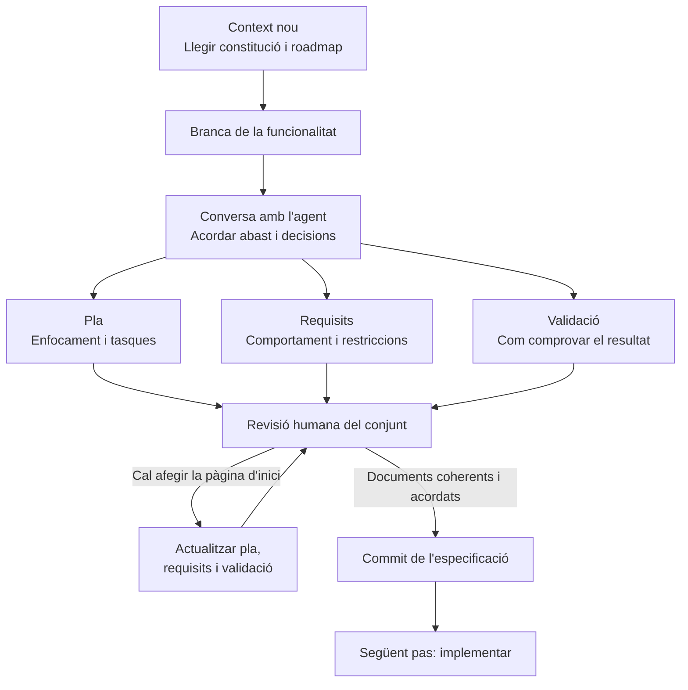

# 07 · Feature Specification

[← Índex](../README.md) · [← Creating the Constitution](06-creating-the-constitution.md) · [Vídeo i transcripció](https://learn.deeplearning.ai/courses/spec-driven-development-with-coding-agents/lesson/15v9p3/feature-specification)

**Idea central:** abans de programar una funcionalitat, acordar què farà, com s'abordarà i com es comprovarà el resultat.

## 1. Conceptes clau

### Definició de la funcionalitat

| Keyword | Significat |
|---|---|
| **Feature specification** | **Especificació de la funcionalitat.** Acord documentat sobre el pla, els requisits i la validació d'una funcionalitat concreta. |
| **Scope** | **Abast.** Què inclou la funcionalitat que es desenvoluparà en aquesta fase. |
| **Feature plan** | **Pla de la funcionalitat.** Enfocament, ordre de les tasques i manera de validar l'èxit. |
| **Requirements** | **Requisits.** Comportaments esperats i necessitats o restriccions tècniques importants. |
| **Validation scorecard** | **Pauta de validació.** Criteris i comprovacions que permeten decidir si el resultat és correcte. |

### Preparació i control del treball

| Keyword | Significat |
|---|---|
| **Fresh agent context** | **Context nou de l'agent.** Iniciar una sessió sense dependre de la conversa anterior i recuperar les decisions des de la constitució. |
| **Feature branch** | **Branca de la funcionalitat.** Branca separada on es treballa aquesta funcionalitat. |
| **Pin a version** | **Fixar una versió.** Indicar quina versió d'una dependència s'ha d'utilitzar. |
| **Strict TypeScript** | **TypeScript en mode estricte.** Configuració que exigeix comprovacions de tipus més rigoroses. |
| **Oversteer** | **Dirigir en excés.** Imposar detalls menors, com noms de variables, quan l'agent els pot resoldre. |

## 2. L'exemple i el diagrama

### Què preparen a AgentClinic?

La primera funcionalitat del full de ruta s'anomena **Hello Hono**. En aquesta lliçó **encara no la implementen**: en preparen l'especificació.

| Decisió | Què acorden al vídeo |
|---|---|
| Abast inicial | Mantenir el que estableix la fase 1 del full de ruta. |
| Dependència | Fixar la versió de Hono, el framework web de l'exemple. La transcripció no n'indica el número. |
| Tipus | Exigir TypeScript estricte. |
| Comprovació inicial | Fer peticions manuals amb curl per comprovar les respostes del servidor. |
| Ajust durant la revisió | Afegir una pàgina d'inici provisional amb una presentació visual cuidada. |

### Com ho fan?

1. **Inicien un context nou** i indiquen que la constitució és la referència del projecte.
2. **Treballen en una branca pròpia** per a la funcionalitat.
3. **Concreten les decisions amb l'agent**, que prepara documents Markdown amb el pla, els requisits i la validació.
4. **Revisen els documents** i demanen afegir la pàgina d'inici provisional.
5. **L'agent actualitza els documents relacionats** perquè el pla, els requisits i la validació incloguin el canvi.
6. **Revisen el conjunt i fan un commit** abans de començar a implementar.

**Què cal entendre de l'ajust de la pàgina d'inici?** No n'hi ha prou d'afegir-la al pla: els requisits han de descriure-la i la validació ha de permetre comprovar-la.

**Quin nivell de detall cal?** Fixar decisions importants, com versions i restriccions. Deixar a l'agent els detalls menors d'implementació.

**Qui decideix?** La persona revisa les propostes, qüestiona possibles conflictes i pot demanar alternatives. No cal acceptar automàticament les solucions de l'agent.

## 3. Contrast amb la vostra metodologia de l'Sprint 1.2

Compareu la funció dels vostres documents d'OpenSpec amb la proposta del vídeo, encara que tinguin noms diferents.

| Aspecte del vídeo | Ja ho contemplàveu? Com? | Com us va funcionar? | Què milloraríeu o mantindríeu? Per què? |
|---|---|---|---|
| Recuperar el context del projecte des dels documents en iniciar una sessió nova. | | | |
| Treballar la funcionalitat en una branca pròpia. | | | |
| Acordar abast, pla, requisits i comprovacions abans d'implementar. | | | |
| Distingir les restriccions importants dels detalls que es poden delegar. | | | |
| Actualitzar la validació i els requisits quan canvia el pla. | | | |
| Revisar i registrar l'especificació amb Git abans de generar el codi. | | | |
