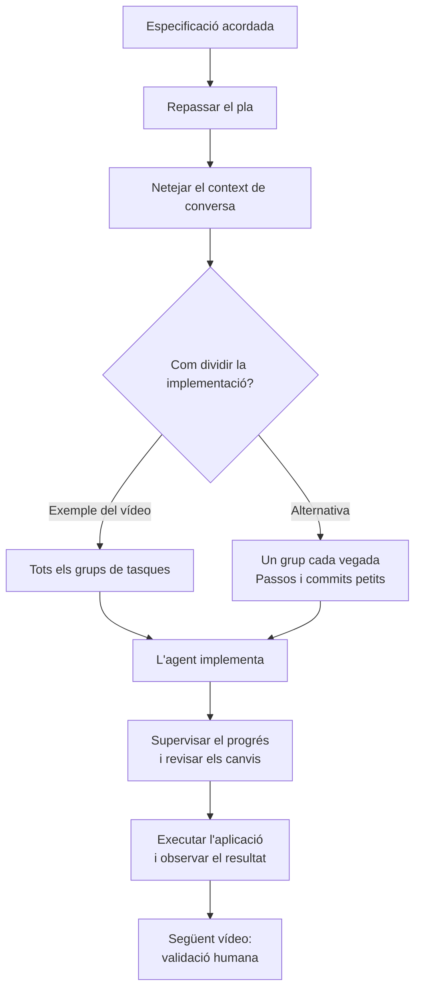

# 08 · Feature implementation

[← Índex](../README.md) · [← Feature Specification](07-feature-specification.md) · [Vídeo i transcripció](https://learn.deeplearning.ai/courses/spec-driven-development-with-coding-agents/lesson/eg5lav/feature-implementation)

**Idea central:** l'agent implementa l'especificació acordada; la persona supervisa els canvis i comprova el resultat. La validació humana es treballarà al vídeo següent.

## 1. Conceptes clau

### Execució del pla

| Keyword | Significat |
|---|---|
| **Implementation** | **Implementació.** Convertir el pla i els requisits de la funcionalitat en codi executable. |
| **Task groups** | **Grups de tasques.** Blocs del pla que es poden implementar tots seguits o d'un en un. |
| **Clear context** | **Netejar el context.** Començar la implementació sense arrossegar la conversa de planificació. Els documents de l'especificació conserven els acords necessaris. |
| **Small steps and commits** | **Passos i commits petits.** Dividir el treball per facilitar-ne la revisió i evitar que els errors s'acumulin. |

### Supervisió i revisió

| Keyword | Significat |
|---|---|
| **Architect / Supervisor** | **Arquitecte / Supervisor.** Paper de la persona: donar directrius clares i revisar el treball de l'agent. |
| **Contract** | **Acord de treball.** L'especificació que defineix què s'espera de la implementació. |
| **Changes** | **Canvis.** Modificacions dels fitxers que cal inspeccionar, més enllà del resum que presenta l'agent. |
| **Validation** | **Validació.** Comprovació del resultat. El vídeo distingeix la que ha fet l'agent de la revisió humana posterior. |

## 2. L'exemple i el diagrama

### Què implementen a AgentClinic?

Continuen amb **Hello Hono**, la primera funcionalitat del full de ruta. L'especificació ja està preparada al vídeo anterior.

| Pas | Què fan al vídeo |
|---|---|
| 1. Revisar | Repassen breument el pla de la funcionalitat. |
| 2. Netejar el context | Utilitzen `/clear` a Claude Code abans de demanar la implementació. |
| 3. Implementar | Demanen a l'agent que executi tots els grups de tasques. |
| 4. Supervisar | Observen el progrés a la consola i inspeccionen els canvis a la vista de commit de l'IDE. |
| 5. Llegir el resum | Consulten què ha fet l'agent per a cada grup de tasques. |
| 6. Executar | Inicien l'aplicació des de `package.json` i veuen el resultat al navegador. |

**Veure l'aplicació al navegador és una primera comprovació.** La lliçó acaba indicant que l'agent ja ha fet la seva validació; la persona farà la seva al vídeo següent. No s'hi detallen les comprovacions executades per l'agent.

**Quan convé anar per grups?** El vídeo destaca àrees com la seguretat i les bases de dades, on petits errors poden tenir efectes en les tasques posteriors.

**Amb les vostres eines:** `/clear` és l'ordre usada a Claude Code. Amb un altre agent, utilitzeu la seva opció equivalent o una sessió nova, assegurant que recupera l'especificació del projecte.

## 3. Contrast amb la vostra metodologia de l'Sprint 1.2

Respon amb evidències de la implementació que vau fer amb OpenSpec.

| Aspecte del vídeo | Ja ho contemplàveu? Com? | Com us va funcionar? | Què milloraríeu o mantindríeu? Per què? |
|---|---|---|---|
| Començar la implementació amb context nou i l'especificació com a referència. | | | |
| Decidir si implementar tot el pla o avançar per grups de tasques. | | | |
| Fer passos i commits petits quan un error pot afectar el treball posterior. | | | |
| Inspeccionar els canvis reals, a més del resum de l'agent. | | | |
| Executar l'aplicació i distingir les comprovacions de l'agent de la validació humana. | | | |
