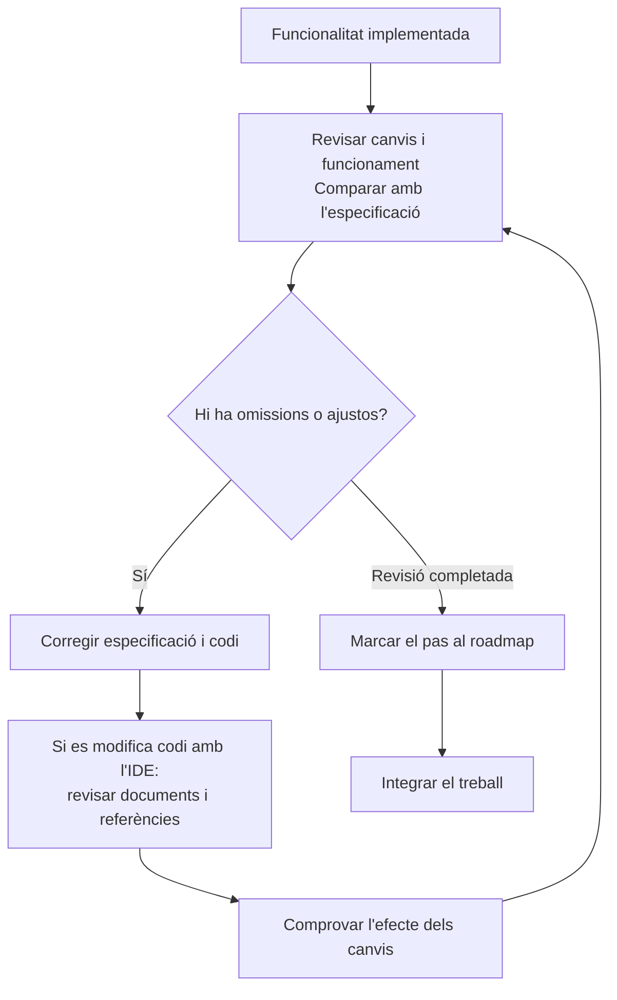

# 09 · Feature validation

[← Índex](../README.md) · [← Feature implementation](08-feature-implementation.md) · [Vídeo i transcripció](https://learn.deeplearning.ai/courses/spec-driven-development-with-coding-agents/lesson/0kj4sj/feature-validation)

**Idea central:** abans d'integrar la funcionalitat, revisar que funciona i respon a l'especificació. Si es detecta una omissió, corregir tant els documents com el codi.

## 1. Conceptes clau

### Revisió del resultat

| Keyword | Significat |
|---|---|
| **Code review** | **Revisió de codi.** Inspecció dels canvis. El vídeo prioritza el funcionament i la correspondència amb l'especificació. |
| **Human-in-the-loop** | **Participació humana durant el procés.** L'agent genera o modifica; la persona revisa i decideix si cal corregir. |
| **Cognitive debt** | **Deute cognitiu.** Càrrega mental de comprendre què fa el codi i com ha evolucionat. Els canvis petits i revisables ajuden a reduir-la. |
| **Tests** | **Proves.** Comprovacions que ajuden a detectar si un canvi ha trencat alguna cosa. En l'exemple encara falta instal·lar el paquet de proves. |

### Coherència i integració

| Keyword | Significat |
|---|---|
| **Drift** | **Desviació entre documents i codi.** Apareix quan una modificació deixa desactualitzats l'especificació, el README o altres artefactes. |
| **Refactoring** | **Refactorització.** Reorganització del codi mantenint-ne el comportament. Al vídeo separen components en fitxers propis amb l'IDE. |
| **Merge** | **Integració de branques.** Incorporació del treball de la funcionalitat després de revisar-lo i donar-lo per acabat. |
| **Spec versioning** | **Control de versions de les especificacions.** Registre de la seva evolució i de la relació amb els canvis de codi. El vídeo el presenta com una qüestió encara en debat. |

## 2. L'exemple i el diagrama

### Què detecten a AgentClinic?

La pàgina inicial funciona, però **Home.tsx és massa mínim per al que ara volen**. En revisar el pla, veuen que no havien demanat l'estructura desitjada.

| Situació | Què fan |
|---|---|
| Falta una estructura de pàgina clara. | Demanen un component de layout amb capçalera, contingut principal i peu com a subcomponents, i un fitxer CSS. |
| L'estructura no estava prevista al pla. | L'agent actualitza l'especificació i la implementació. Afegeix un grup de tasques al pla. |
| Els subcomponents han quedat al mateix fitxer. | La persona els mou a fitxers propis amb l'eina de l'IDE, per seguir les convencions. |
| El moviment manual pot deixar referències antigues. | Demanen a l'agent que revisi i actualitzi els documents afectats. |
| Falta el paquet de proves. | Deixen aquesta necessitat comuna a totes les funcionalitats per a la lliçó següent. |
| La funcionalitat es dona per acabada. | Marquen el pas al full de ruta i integren els resultats. |

**Una omissió al pla pot arribar al codi.** En aquest cas, no n'hi ha prou de corregir la pàgina: cal deixar documentat el nou acord.

El diagrama resumeix el cicle de revisió; **el vídeo no mostra una bateria de proves automatitzades**. Identifica que falta preparar aquesta infraestructura.

### Dues decisions a retenir

- **Podeu fer canvis directament amb l'IDE**, però després cal mantenir coherents el codi i els documents relacionats.
- **Un petit canvi al roadmap pot anar a la branca de la funcionalitat.** Si la revisió de la constitució és més àmplia, el vídeo suggereix considerar una branca separada.

## 3. Contrast amb la vostra metodologia de l'Sprint 1.2

Utilitzeu exemples de la funcionalitat que heu treballat amb OpenSpec.

| Aspecte del vídeo | Ja ho contemplàveu? Com? | Com us va funcionar? | Què milloraríeu o mantindríeu? Per què? |
|---|---|---|---|
| Revisar el funcionament i la correspondència amb l'especificació abans d'integrar. | | | |
| Detectar si un problema del codi prové d'una omissió a l'especificació. | | | |
| Actualitzar els documents quan corregiu o reorganitzeu el codi. | | | |
| Mantenir els canvis prou petits per entendre'ls i revisar-los. | | | |
| Comprovar que els ajustos no trenquen comportaments previs i identificar quines proves falten. | | | |
| Registrar l'estat al roadmap i decidir en quina branca actualitzar els acords del projecte. | | | |
