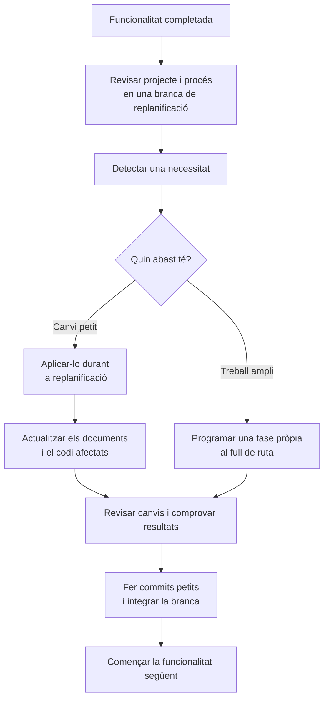

# 10 · Project replanning

[← Índex](../README.md) · [← Feature validation](09-feature-validation.md) · [Vídeo i transcripció](https://learn.deeplearning.ai/courses/spec-driven-development-with-coding-agents/lesson/zqwpt5/project-replanning)

**Idea central:** entre funcionalitats, revisar què hem après i ajustar els acords del projecte, el full de ruta i la manera de treballar.

## 1. Conceptes clau

### Revisió del projecte

| Keyword | Significat |
|---|---|
| **Replanning** | **Replanificació.** Moment per revisar decisions abans de començar la funcionalitat següent. |
| **Living document** | **Document viu.** La constitució es pot modificar quan apareixen necessitats noves. Els canvis s'han de registrar. |
| **Replanning branch** | **Branca de replanificació.** Separa les revisions dels acords generals del desenvolupament d'una funcionalitat. Ajuda a seguir quina versió de les especificacions correspon al codi. |
| **Responsive design** | **Disseny adaptable.** Interfície que s'ajusta a diferents mides de pantalla, inclosos els mòbils. |
| **Roadmap** | **Full de ruta.** Ordre de les fases previstes, que es revisa a partir de l'experiència. |

### Millora del procés

| Keyword | Significat |
|---|---|
| **Testing framework** | **Entorn de proves.** Eines per escriure i executar proves. Cal comprovar tant la configuració com l'existència de les proves. |
| **Debugger** | **Depurador.** Eina per seguir l'execució pas a pas i comprendre el comportament del codi. |
| **Skill** | **Habilitat de l'agent.** Paquet d'instruccions i recursos per executar un procés definit i repetible. |
| **Global skill** | **Habilitat global.** Disponible en diversos projectes, en lloc de quedar limitada a un repositori. |
| **Changelog** | **Registre de canvis.** Resum de l'evolució del projecte per comunicar-la a les parts interessades i als agents. |

## 2. L'exemple i el diagrama

### Què revisen a AgentClinic?

Després de completar **Hello Hono**, creen una branca de replanificació i fan quatre ajustos:

| Ajust | Què passa al vídeo | Què cal entendre |
|---|---|---|
| **Afegir proves** | Actualitzen la política de proves de la constitució i demanen adaptar també les especificacions i el codi existents. Han de demanar explícitament que s'escriguin proves; després les executen amb el depurador. | Canviar una norma general no garanteix que el treball anterior quedi adaptat. Configurar les proves tampoc equival a escriure-les. |
| **Adaptar el disseny a mòbils** | En l'exemple, el responsable de producte informa que el 40 % dels usuaris utilitza mòbil. Demanen actualitzar el disseny, les especificacions del producte i les de la funcionalitat. | Una necessitat nova ha de quedar reflectida tant als acords com al codi. |
| **Reordenar el full de ruta** | Consideren que les funcionalitats 2, 3, 4 i 5 estan relacionades i les agrupen en un mateix pas. | El full de ruta es revisa; no cal seguir-lo sense qüestionar-lo. La transcripció no detalla aquestes funcionalitats. |
| **Crear una habilitat de changelog** | Demanen a l'agent una habilitat per mantenir el registre de canvis. L'agent la crea a l'àrea global i la utilitza per generar el CHANGELOG del projecte. La persona el revisa. | Un procés repetible es pot convertir en una habilitat reutilitzable. Cal decidir si ha de ser pròpia del projecte o comuna a diversos projectes. |

**Compte amb les proves:** al primer intent, l'agent només afegeix un script a package.json, sense una dependència nova. El vídeo mostra que cal revisar el que s'ha fet i demanar els passos que falten; no concreta a la transcripció quin paquet de proves acaba utilitzant.

### Fer el canvi ara o programar-lo?

El canvi per a mòbils es fa directament perquè el projecte encara és petit. Si impliqués molta feina, el vídeo recomana planificar-lo com una funcionalitat pròpia.

### Automatitzar després d'acordar el procés

El vídeo proposa actualitzar el changelog en cada integració a main. Mostra la creació i l'ús de l'habilitat, però **no demostra que s'hagi configurat una execució automàtica en cada merge**.

També suggereix una habilitat de validació que agrupi actualització del README, revisió de regles de codi, format, escriptura de proves i altres comprovacions.

**La revisió humana es manté:** la persona inspecciona els canvis, comprova els resultats i revisa el changelog abans de donar el treball per acabat.

## 3. Contrast amb la vostra metodologia de l'Sprint 1.2

Si només heu aplicat la metodologia a una funcionalitat, indiqueu què revisaríeu abans de començar la següent.

| Aspecte del vídeo | Ja ho contemplàveu? Com? | Com us va funcionar? | Què milloraríeu o mantindríeu? Per què? |
|---|---|---|---|
| Reservar un moment de replanificació entre funcionalitats. | | | |
| Registrar en una branca pròpia els canvis generals de la metodologia o del projecte. | | | |
| Adaptar també les especificacions i el codi anteriors quan canvia una norma comuna. | | | |
| Comprovar que les proves estan configurades, escrites i executades. | | | |
| Distingir un ajust petit d'una necessitat que requereix una fase pròpia. | | | |
| Revisar l'ordre i l'agrupació de les funcionalitats del full de ruta. | | | |
| Convertir tasques repetides en habilitats i decidir si són locals o reutilitzables entre projectes. | | | |
| Mantenir un registre de canvis comprensible i revisar-lo abans de compartir-lo. | | | |
