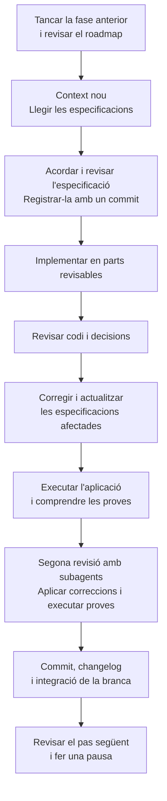

# 11 · The second feature phase

[← Índex](../README.md) · [← Project replanning](10-project-replanning.md) · [Vídeo i transcripció](https://learn.deeplearning.ai/courses/spec-driven-development-with-coding-agents/lesson/bvlyk2/the-second-feature-phase)

**Idea central:** repetir el cicle d'especificació, implementació i validació amb canvis que puguem comprendre i revisar. Tancar una fase abans de començar la següent ajuda a evitar la fatiga.

## 1. Conceptes clau

### Context i càrrega de revisió

| Keyword | Significat |
|---|---|
| **AI fatigue** | **Fatiga associada al treball amb IA.** Esgotament que provoca revisar grans quantitats de codi i canvis generats per agents. |
| **Clean break** | **Separació clara entre fases.** Tancar el treball anterior, integrar-lo i confirmar el pas següent abans de continuar. |
| **Context budget** | **Capacitat disponible de context.** Espai limitat que l'agent pot dedicar al treball actual. Una sessió nova permet centrar-lo en la funcionalitat següent. |
| **Cognitive debt** | **Deute cognitiu.** Dificultat acumulada per comprendre el codi i la seva evolució. Validar també implica entendre els canvis. |

### Decisions i eines de l'exemple

| Keyword | Significat |
|---|---|
| **Plain SQL migrations** | **Migracions amb SQL directe.** Canvis versionats de la base de dades expressats amb instruccions SQL. És l'opció triada a la conversa. |
| **PicoCSS** | Framework CSS que decideixen utilitzar per a la presentació visual. |
| **Props / TypeScript type** | **Propietats d'un component / Tipus de TypeScript.** Demanen separar la definició del tipus de les props en lloc de deixar-la escrita directament al component. |
| **Sub-agents** | **Subagents.** Agents als quals es deleguen revisions parcials per obtenir una segona mirada i preservar el context de l'agent principal. |
| **Changelog skill** | **Habilitat de registre de canvis.** Instruccions reutilitzables per documentar el que s'ha fet abans d'integrar la branca. |

## 2. L'exemple i el diagrama

### Abans de començar

El vídeo proposa comprovar quatre coses:

- **No queda treball pendent** de la fase anterior.
- **La branca anterior està integrada** a main.
- **El pas següent del roadmap continua sent adequat.**
- **L'agent comença amb context nou** i recupera les decisions de les especificacions.

### Què fan a AgentClinic?

La fase següent s'anomena **agents and ailments**: agents i malalties fictícies de la clínica. Manté agrupades les funcionalitats acordades durant la replanificació.

| Moment | Acció concreta |
|---|---|
| **Especificar** | Confirmen l'agrupació de funcionalitats i trien migracions amb SQL directe. |
| **Ajustar** | Afegeixen PicoCSS als requisits i demanen que els altres documents reflecteixin el canvi. Revisen i fan un commit de l'especificació. |
| **Implementar** | L'agent construeix la funcionalitat. El vídeo recorda que es pot demanar només una part del pla si el conjunt és massa gran. |
| **Revisar** | Demanen extreure els tipus de les props a definicions pròpies de TypeScript a tot el codi. Les decisions descobertes durant la revisió s'han de recollir a l'especificació. |
| **Validar i comprendre** | Executen l'aplicació, llegeixen proves i les segueixen amb el depurador. |
| **Fer una segona revisió** | Demanen una revisió profunda amb subagents. Revisen les incidències i recomanacions; l'agent aplica correccions i executa proves. |
| **Tancar** | Fan un commit, utilitzen l'habilitat de changelog, registren el document i integren la branca. Després revisen el pas següent del roadmap. |

La transcripció no enumera les opcions de validació seleccionades a l'entrevista ni les incidències concretes trobades pels subagents.

La segona revisió amb subagents és una tècnica de suport mostrada al vídeo, no un requisit per a qualsevol funcionalitat ni una garantia que no quedin errors.

**Dues idees a retenir:**

- **Observar el progrés de l'agent no substitueix revisar-ne el resultat.** Cal entendre el codi que assumim com a propi.
- **Descobrir una decisió nova no implica que l'especificació hagi fracassat.** Cal incorporar-la perquè orienti el treball futur.

## 3. Contrast amb la vostra metodologia de l'Sprint 1.2

Si encara no heu començat una segona funcionalitat, concreteu què aplicaríeu en la transició.

| Aspecte del vídeo | Ja ho contemplàveu? Com? | Com us va funcionar? | Què milloraríeu o mantindríeu? Per què? |
|---|---|---|---|
| Tancar el treball anterior i revisar el roadmap abans de començar una fase nova. | | | |
| Iniciar context nou a partir de documents que recullen les decisions. | | | |
| Dividir la implementació per poder comprendre i revisar tots els canvis. | | | |
| Incorporar a les especificacions les decisions descobertes durant la revisió. | | | |
| Llegir i depurar proves per entendre el codi, a més de comprovar que funciona. | | | |
| Fer una segona revisió, amb subagents si l'eina ho permet i és útil. | | | |
| Actualitzar el changelog i integrar la branca abans de passar a la fase següent. | | | |
