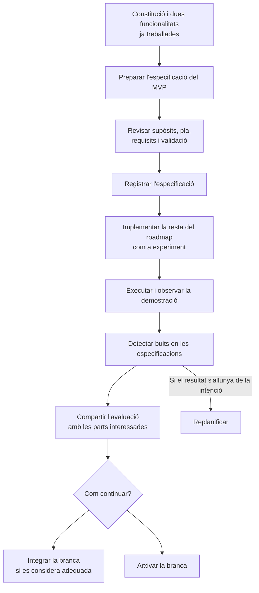

# 12 · The MVP

[← Índex](../README.md) · [← The second feature phase](11-the-second-feature-phase.md) · [Vídeo i transcripció](https://learn.deeplearning.ai/courses/spec-driven-development-with-coding-agents/lesson/gy3d4m/the-mvp)

**Idea central:** utilitzar una implementació més àmplia com a experiment per comprovar si les especificacions orienten bé l'agent i descobrir què falta en la planificació.

## 1. Conceptes clau

### Producte i experimentació

| Keyword | Significat |
|---|---|
| **MVP — Minimum Viable Product** | **Producte mínim viable.** Versió limitada que permet contrastar el producte amb les parts interessades. Al vídeo serveix com a demostració i experiment sobre la qualitat de les especificacions. |
| **Stakeholder review** | **Revisió de les parts interessades.** Valoració de la demostració i de les mancances detectades per decidir com continuar. |
| **Sample data** | **Dades d'exemple.** Dades utilitzades per mostrar el funcionament. En la demostració es consulten des de la base de dades. |

### Qualitat de les especificacions

| Keyword | Significat |
|---|---|
| **Assumptions** | **Supòsits.** Decisions que l'agent pren per omplir buits d'informació i que cal revisar. |
| **Spec validation** | **Validació de les especificacions.** Revisar si els documents orienten prou bé la construcció del producte i on hi ha mancances. |
| **Replanning** | **Replanificació.** Revisar els acords i el pla quan el resultat s'allunya del que es volia. |
| **Merge / Archive the branch** | **Integrar / Arxivar la branca.** Alternatives que el vídeo planteja després de valorar l'experiment. Generar el codi no obliga a integrar-lo. |

## 2. L'exemple i el diagrama

### Què fan a AgentClinic?

Ja han implementat dues funcionalitats. Ara la direcció demana un MVP i decideixen **provar d'implementar la resta del roadmap en un bloc ampli**.

| Pas | Què fan |
|---|---|
| **1. Preparar l'experiment** | Adapten el prompt habitual per cobrir la resta del full de ruta, amb orientacions sobre les especificacions ja existents. |
| **2. Aclarir decisions** | Responen les preguntes de l'agent i guarden l'especificació del MVP. |
| **3. Revisar abans de generar** | Revisen pla, requisits i validació per detectar supòsits incorrectes. Fan un commit de l'especificació. |
| **4. Implementar i observar** | L'agent genera el conjunt. Executen l'aplicació: les seccions mostren més contingut, amb dades d'exemple de la base de dades. |
| **5. Avaluar les especificacions** | Demanen a l'agent que detecti mancances de la planificació a partir de l'experiment. |
| **6. Decidir com continuar** | Proposen compartir l'avaluació amb les parts interessades i, després de revisar el MVP, integrar o arxivar la branca. |

La transcripció no enumera les funcionalitats afegides ni les mancances concretes que identifica l'agent.

### Què canvia respecte dels vídeos anteriors?

- **L'abast és més gran:** és una prova deliberada de la constitució i de les especificacions acumulades.
- **L'atenció passa també als documents:** a més d'observar el producte, busquen buits en la planificació.
- **El resultat és una demostració útil per prendre decisions:** el vídeo no acredita una validació completa del codi ni que estigui preparat per a producció.

El vídeo condiciona aquest pas ampli a dues coses: **confiar en la qualitat de les especificacions i poder assumir la revisió i la validació del resultat**. No proposa abandonar els passos petits com a pràctica habitual.

**Pregunta clau:** el resultat és diferent perquè el codi no compleix els acords o perquè els acords no expressaven prou bé el que volíem?

## 3. Contrast amb la vostra metodologia de l'Sprint 1.2

No cal construir un MVP per fer aquest contrast. Utilitzeu el resultat de la funcionalitat que ja heu treballat per valorar la qualitat dels vostres documents d'OpenSpec.

| Aspecte del vídeo | Ja ho contemplàveu? Com? | Com us va funcionar? | Què milloraríeu o mantindríeu? Per què? |
|---|---|---|---|
| Decidir l'abast que podeu implementar sense superar la vostra capacitat de revisió. | | | |
| Revisar els supòsits de l'agent abans de generar codi. | | | |
| Utilitzar el resultat per detectar buits en els requisits i el pla. | | | |
| Distingir un error d'implementació d'una intenció que no havia quedat documentada. | | | |
| Compartir el resultat i les mancances amb les persones que han de valorar-lo. | | | |
| Decidir si integrar el treball, replanificar o conservar l'experiment sense integrar-lo. | | | |
