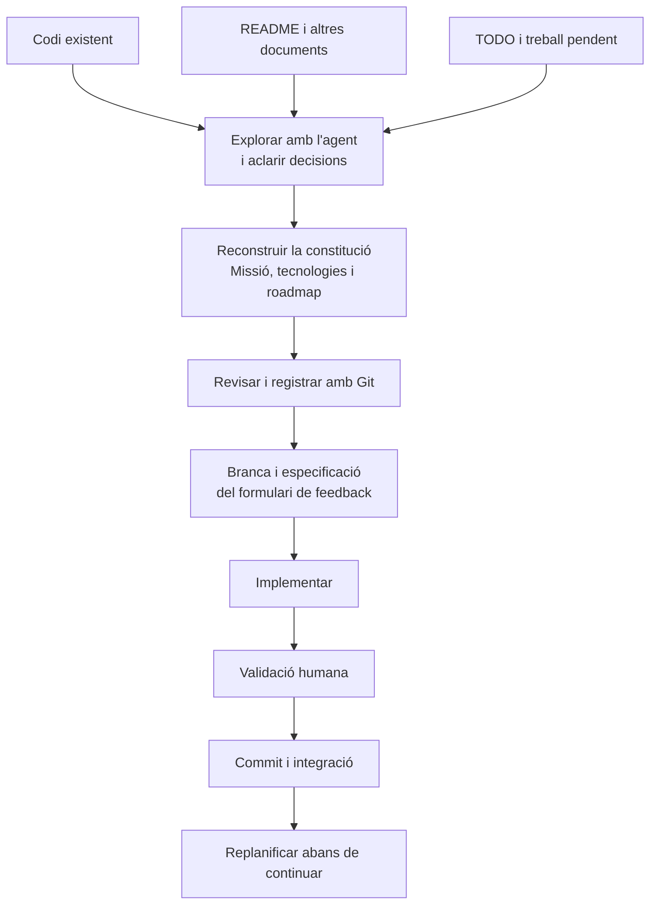

# 13 · Legacy support

[← Índex](../README.md) · [← The MVP](12-the-mvp.md) · [Vídeo i transcripció](https://learn.deeplearning.ai/courses/spec-driven-development-with-coding-agents/lesson/k2c6hq/legacy-support)

**Idea central:** per introduir SDD en un projecte existent, reconstruir els acords del projecte a partir del codi i dels documents disponibles. Després, continuar amb el cicle habitual de funcionalitats.

## 1. Conceptes clau

### Comprensió del projecte existent

| Keyword | Significat |
|---|---|
| **Legacy project / Brownfield** | **Projecte existent.** Base de codi que ja funciona i que cal comprendre abans de modificar. No implica necessàriament que sigui antiga o estigui mal feta. |
| **Reverse engineering** | **Enginyeria inversa.** Analitzar el codi i els documents per reconstruir com està organitzat el projecte i quines decisions hi ha reflectides. |
| **Existing artifacts** | **Artefactes existents.** Fonts de context: README, tasques pendents, historial de commits, gestors d'incidències o altres documents. |
| **Constitution** | **Constitució.** Missió, tecnologies i full de ruta reconstruïts i aclarits amb la persona per orientar els canvis futurs. |

### Continuïtat del desenvolupament

| Keyword | Significat |
|---|---|
| **Roadmap** | **Full de ruta.** Organització del treball pendent en fases, aprofitant les tasques ja documentades. |
| **Versioning strategy** | **Estratègia de control de versions.** Inclou registrar les especificacions amb Git, a més del codi. |
| **Feature loop** | **Cicle de funcionalitat.** Especificar, revisar, implementar, validar i integrar una funcionalitat. |
| **Replanning** | **Replanificació.** Revisar els acords i el procés després de la primera aplicació de SDD al projecte. |

## 2. L'exemple i el diagrama

### Com simulen un projecte existent?

Parteixen del **MVP d'AgentClinic**, en un altre directori i una sessió nova de Claude Code, sense la carpeta d'especificacions. Conserven:

- **El codi** de l'aplicació.
- **README.md**, amb informació del projecte.
- **TODO.md**, amb feina pendent.

És una preparació de la demostració, no una instrucció d'esborrar les especificacions dels vostres projectes.

### Com hi introdueixen SDD?

| Pas | Què fan al vídeo |
|---|---|
| **1. Explorar** | Demanen a l'agent que analitzi el codi i els documents. Indiquen que busqui el treball futur al TODO.md. |
| **2. Reconstruir els acords** | L'agent prepara la missió, les tecnologies i el full de ruta, amb els aclariments de la conversa. |
| **3. Revisar i registrar** | Revisen la constitució: públic i idea del projecte, estructura de fitxers, versions dels frameworks i fases relacionades amb les tasques pendents. Fan un commit. |
| **4. Especificar una funcionalitat** | Trien la primera fase: un formulari de feedback. Creen una branca, revisen pla, requisits i validació, i registren l'especificació. |
| **5. Implementar i validar** | Aclareixen els ajustos amb l'agent, implementen i comproven el codi i el funcionament. Fan un commit i integren la branca a main. |
| **6. Replanificar** | Reserven temps per ajustar el procés acabat d'introduir. |

La transcripció no concreta els camps del formulari ni les comprovacions de validació.

**Què canvia respecte d'un projecte des de zero?** El punt de partida: primer cal comprendre i documentar el que ja existeix. El cicle de desenvolupament posterior és el mateix.

**Què no pot deduir l'agent amb certesa?** El codi mostra què està implementat, però no sempre per què es va decidir així. Aporteu el context que conegueu i reviseu les interpretacions que proposi.

## 3. Contrast amb la vostra metodologia de l'Sprint 1.2

Aquest cas connecta directament amb el vostre treball: aplicar una metodologia amb agents sobre una funcionalitat que ja havíeu desenvolupat amb altres metodologies.

| Aspecte del vídeo | Ja ho contemplàveu? Com? | Com us va funcionar? | Què milloraríeu o mantindríeu? Per què? |
|---|---|---|---|
| Analitzar el codi i els documents abans de demanar modificacions. | | | |
| Distingir les decisions que es poden observar al codi de les que cal aclarir amb les persones. | | | |
| Aprofitar les tasques pendents per construir el full de ruta. | | | |
| Revisar i registrar els acords reconstruïts abans de desenvolupar. | | | |
| Definir pla, requisits i validació per a la funcionalitat sobre el projecte existent. | | | |
| Revisar la metodologia després d'aplicar-la i documentar els ajustos necessaris. | | | |
