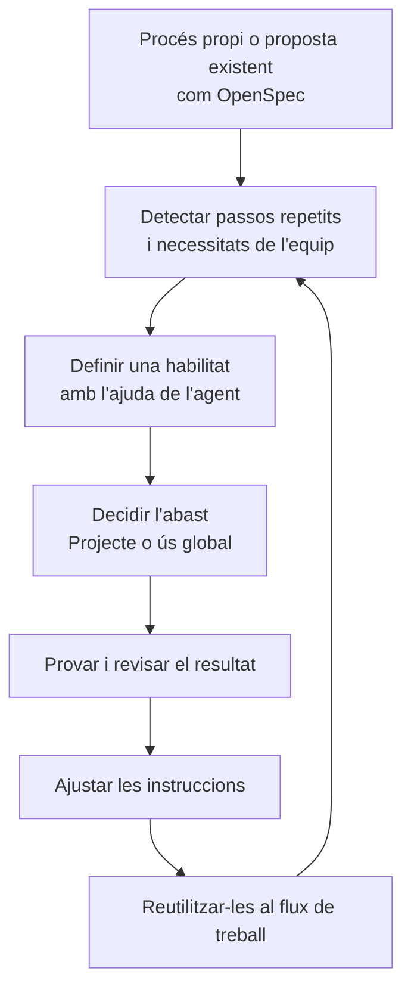

# 14 · Build your own workflow

[← Índex](../README.md) · [← Legacy support](13-legacy-support.md) · [Vídeo i transcripció](https://learn.deeplearning.ai/courses/spec-driven-development-with-coding-agents/lesson/2fn0li/build-your-own-workflow)

**Idea central:** adaptar el procés a l'equip i automatitzar les tasques repetides. Podeu partir d'OpenSpec o d'una altra proposta i afegir-hi les vostres instruccions.

## 1. Conceptes clau

### Automatització del procés

| Keyword | Significat |
|---|---|
| **Skill / Agent Skills** | **Habilitat de l'agent.** Instruccions i recursos reutilitzables per fer una tasca. El vídeo presenta Agent Skills com un estàndard obert. |
| **Skill creator** | **Creador d'habilitats.** Recurs de l'agent que ajuda a redactar una habilitat a partir d'una conversa. |
| **Project / Global skill** | **Habilitat del projecte / Global.** Disponible només en un projecte o reutilitzable en diversos projectes. |
| **Progressive disclosure** | **Càrrega progressiva d'informació.** L'agent consulta la descripció de les habilitats i carrega les instruccions que considera necessàries. Si voleu una habilitat concreta, el vídeo recomana anomenar-la explícitament. |

### Eines i recursos

| Keyword | Significat |
|---|---|
| **CLI — Command Line Interface** | **Interfície de línia d'ordres.** Via per executar eines des del terminal; una habilitat pot indicar a l'agent com utilitzar-les. |
| **MCP — Model Context Protocol** | Protocol per connectar l'agent amb eines i fonts externes, com APIs, bases de dades o documentació. |
| **Context7** | Servei de consulta de documentació de biblioteques. A la demostració el configuren mitjançant CLI i habilitats. |
| **Plugin** | **Complement.** Paquet d'extensions que es pot instal·lar i actualitzar. El vídeo adverteix que pot executar codi i que la compatibilitat depèn de l'agent. |

### Organització del treball

| Keyword | Significat |
|---|---|
| **Workflow** | **Flux de treball.** Passos i regles que l'equip utilitza per especificar, implementar i revisar. |
| **Spec Kit / OpenSpec** | Propostes de fluxos de treball SDD amb estructures i eines pròpies. El vídeo proposa experimentar-hi i adaptar-les. |
| **Research backlog** | **Recull de recerques pendents de decidir.** Informes d'idees explorades que encara no s'han incorporat al full de ruta. |
| **Roadmap** | **Full de ruta.** Treball que s'ha decidit planificar. Una recerca pot quedar fora fins que s'acordi desenvolupar-la. |

## 2. Els exemples i el diagrama

### Tres exemples del vídeo

| Necessitat | Què fan | Per a què serveix |
|---|---|---|
| **Repetir menys prompts** | Demanen al creador d'habilitats que prepari una skill per iniciar l'especificació d'una funcionalitat. Responen preguntes i revisen les decisions. | Reutilitzar les instruccions sobre el procés i els documents que s'han de generar. |
| **Consultar documentació** | Configuren Context7 amb l'opció CLI + Skills i el proven amb un prompt. | Aportar documentació actualitzada de les tecnologies del projecte. |
| **Conservar una idea sense alterar el pla** | Exploren una possible elecció de base de dades i demanen un informe en una ubicació coneguda. | Recuperar els resultats més endavant i, si es decideix, enllaçar-los des del roadmap. |

La transcripció no concreta el contingut complet de l'habilitat ni la base de dades escollida a la recerca.

### Com construir el vostre flux

**Una habilitat no és una connexió externa.** Pot explicar com seguir un procés i com utilitzar eines, però les eines i els accessos necessaris han d'estar disponibles.

**Automatitzar no elimina la revisió.** El vídeo demana observar si l'agent pren les decisions esperades mentre crea i utilitza les habilitats.

### La connexió amb OpenSpec

El vídeo aproxima els passos d'OpenSpec al procés del curs:

| Passos esmentats al vídeo | Relació proposada |
|---|---|
| Propose i explore | Planificació |
| Apply | Implementació |
| Archive | Tancament i connexió amb la replanificació |

És una comparació didàctica del vídeo, no una equivalència completa entre processos. **Arxivar un canvi no substitueix revisar què cal millorar**, i la validació ha de continuar present a la vostra metodologia.

## 3. Contrast amb la vostra metodologia de l'Sprint 1.2

Partiu del flux que heu definit amb OpenSpec. Valoreu què us convé automatitzar després d'haver-ho aplicat.

| Aspecte del vídeo | Ja ho contemplàveu? Com? | Com us va funcionar? | Què milloraríeu o mantindríeu? Per què? |
|---|---|---|---|
| Adaptar OpenSpec a les necessitats de l'equip i justificar els passos propis. | | | |
| Detectar prompts repetits que es podrien convertir en habilitats. | | | |
| Decidir quines instruccions són del projecte i quines es poden reutilitzar. | | | |
| Anomenar explícitament una habilitat quan voleu assegurar-ne l'ús. | | | |
| Aportar documentació adequada a les versions de les eines del projecte. | | | |
| Registrar una recerca sense convertir-la immediatament en feina planificada. | | | |
| Provar i revisar les automatitzacions abans d'incorporar-les al procés habitual. | | | |
