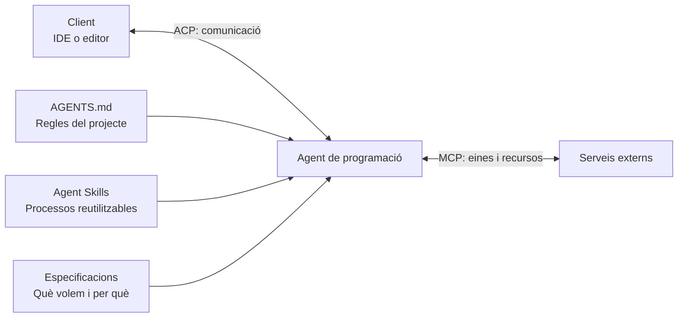

# 15 · Agent replaceability

[← Índex](../README.md) · [← Build your own workflow](14-build-your-own-workflow.md) · [Vídeo i transcripció](https://learn.deeplearning.ai/courses/spec-driven-development-with-coding-agents/lesson/uzfov5/agent-replaceability)

**Idea central:** poder canviar d'agent o d'IDE mantenint les especificacions i el procés de treball. Els estàndards faciliten aquesta portabilitat, si les eines els admeten.

## 1. Conceptes clau

### Portabilitat del procés

| Keyword | Significat |
|---|---|
| **Agent replaceability** | **Possibilitat de substituir l'agent.** Continuar el projecte amb un altre agent sense haver de redefinir la metodologia. |
| **Agent-agnostic workflow** | **Flux independent de l'agent.** Decisions i passos documentats que no depenen exclusivament d'una eina. |
| **AGENTS.md** | Fitxer de regles i instruccions del projecte per als agents que el reconeixen. |
| **Agent Skills** | Format d'habilitats reutilitzables per recollir processos i context. La ubicació dels fitxers pot variar entre agents. |

### Connexió entre eines

| Keyword | Significat |
|---|---|
| **MCP — Model Context Protocol** | Connexió de l'agent amb eines i recursos externs. |
| **ACP — Agent Client Protocol** | Connexió d'un agent amb un client, com un editor. Requereix compatibilitat a les dues bandes. |
| **Client** | **Client.** Aplicació des de la qual s'interactua amb l'agent; al vídeo, l'IDE. |
| **ACP Registry** | **Registre d'agents ACP.** Catàleg que facilita trobar, instal·lar i connectar agents compatibles amb el client. |
| **Benchmark / Leaderboard** | **Avaluació comparativa / Classificació.** Resultats que poden ajudar a comparar agents. El vídeo recomana valorar els criteris propis, perquè les classificacions canvien. |

## 2. Els exemples i el diagrama

### Exemple 1: reutilitzar una habilitat amb Codex

1. Parteixen de l'habilitat per preparar especificacions de funcionalitats, creada anteriorment.
2. La copien a la ubicació que utilitza Codex.
3. Comproven que funciona amb aquest agent.
4. Poden alternar agents en el mateix projecte mantenint el flux SDD.

**Què es conserva?** Les instruccions del procés i les especificacions.

**Què cal adaptar?** En la demostració, la ubicació de l'habilitat. Això no garanteix que qualsevol habilitat funcioni sense ajustos amb qualsevol agent.

### Exemple 2: incorporar OpenCode a l'IDE

1. Des de la finestra de xat d'IA d'un IDE de JetBrains, obren el registre ACP.
2. Seleccionen OpenCode entre els agents compatibles.
3. La instal·lació prepara l'agent i la integració amb l'IDE.
4. L'utilitzen des del mateix editor, al costat dels altres agents.

**Què canvia?** L'agent que executa el treball.

**Què es manté?** L'editor, el projecte i el procés basat en especificacions.

### Cada estàndard resol una necessitat diferent

El diagrama resumeix les funcions presentades al vídeo; no implica que tots els agents admetin totes aquestes opcions.

**Per triar una eina:** comproveu que encaixa amb el vostre IDE, les habilitats i els accessos necessaris, i que en podeu revisar els resultats. Una classificació general no substitueix aquesta comprovació.

## 3. Contrast amb la vostra metodologia de l'Sprint 1.2

No cal instal·lar un agent nou per respondre. Identifiqueu què podríeu reutilitzar i què hauríeu d'adaptar.

| Aspecte del vídeo | Ja ho contemplàveu? Com? | Com us va funcionar? | Què milloraríeu o mantindríeu? Per què? |
|---|---|---|---|
| Mantenir les decisions del projecte fora de l'historial d'un agent concret. | | | |
| Poder continuar amb un altre agent a partir dels documents d'OpenSpec. | | | |
| Separar les instruccions del procés de la configuració pròpia de cada eina. | | | |
| Revisar la compatibilitat i els ajustos necessaris per reutilitzar una habilitat. | | | |
| Distingir la connexió de l'agent amb l'IDE de la connexió amb serveis externs. | | | |
| Escollir l'agent segons les necessitats de l'equip i la qualitat dels resultats revisats. | | | |
