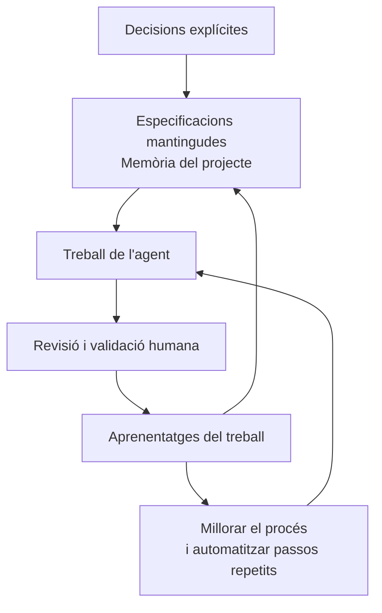

# 16 · Conclusion

[← Índex](../README.md) · [← Agent replaceability](15-agent-replaceability.md) · [Vídeo i transcripció](https://learn.deeplearning.ai/courses/spec-driven-development-with-coding-agents/lesson/wr42e5/conclusion)

**Idea central:** les especificacions conserven les decisions del projecte. La persona continua dirigint el desenvolupament, revisant els resultats i millorant el procés.

## 1. Conceptes clau

| Domini | Keyword | Significat |
|---|---|---|
| Decisions | **Specification** | **Especificació.** Expressa què necessitem i orienta el treball de l'agent. |
| Decisions | **Constitution** | **Constitució.** Recull els acords generals que guien les funcionalitats. |
| Supervisió | **Human-in-the-loop** | **Participació humana durant el procés.** La persona valida els resultats i manté el control. |
| Continuïtat | **Project memory** | **Memòria del projecte.** Metàfora de les especificacions com a registre durador de les decisions. |
| Millora del procés | **Skills and standards** | **Habilitats i estàndards.** Permeten automatitzar i reutilitzar parts del flux de treball. |

## 2. Síntesi i diagrama

### Què recapitula el vídeo?

No introdueix cap funcionalitat nova d'AgentClinic. Resumeix el recorregut del curs:

1. **Acordar el projecte** amb una constitució.
2. **Planificar les funcionalitats** conversant amb l'agent.
3. **Validar els resultats** amb participació humana.
4. **Automatitzar el procés** amb habilitats i estàndards.
5. **Mantenir les especificacions i millorar la metodologia.**

El missatge de tancament és que avançar ràpid no substitueix l'enginyeria: cal conservar la direcció del projecte i comprendre el que s'està construint.

**Aplicat a AgentClinic:** els documents han orientat el desenvolupament i s'han revisat quan han aparegut omissions o necessitats noves. L'objectiu no és escriure documents una vegada, sinó mantenir-los útils.

## 3. Contrast final amb la vostra metodologia de l'Sprint 1.2

Torneu a la metodologia que vau definir amb OpenSpec i a les evidències de la seva aplicació.

| Aspecte del curs | Ja ho contemplàveu? Com? | Com us va funcionar? | Què milloraríeu o mantindríeu? Per què? |
|---|---|---|---|
| Deixar els acords i les decisions en documents que es puguin recuperar. | | | |
| Planificar la funcionalitat abans d'implementar-la. | | | |
| Revisar el resultat i comprendre el codi generat. | | | |
| Mantenir coherents les especificacions i la implementació. | | | |
| Revisar la metodologia a partir de l'experiència i automatitzar els passos útils. | | | |

**Conclusió de l'equip:** indiqueu una decisió que manteniu i una millora que introduiríeu, si n'heu identificat alguna. Justifiqueu-les amb una evidència de la funcionalitat treballada.
